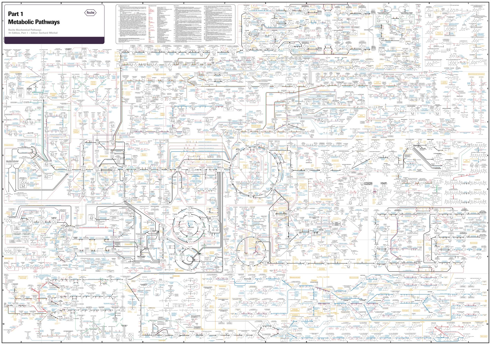

# Biochemical Pathways Poster (Archive)

> **Archived.** The biochemical-pathways.com tile server no longer resolves, so the poster can't be regenerated. This repository now only hosts the last renders made while the server was up.

**Browse and download:** https://usnish.github.io/biochemical-pathways-poster/

Printable renders of Roche's *Biochemical Pathways, Part 1: Metabolic Pathways* poster, assembled from the map tiles Roche hosted on biochemical-pathways.com after it stopped printing the poster.

## Downloads

| File | Format | Dimensions | Size | Source | Captured |
|---|---|---|---|---|---|
| [prebuilt_hires.png](prebuilt_hires.png) | PNG | 13,659 × 9,574 px | 22.6 MB | Zoom level 4 | 2017-04-11 |
| [prebuilt_lores.jpg](prebuilt_lores.jpg) | JPEG | 6,829 × 4,795 px | 13.0 MB | Zoom level 3 | 2016-10-21 |
| [preview.jpg](preview.jpg) | JPEG | 2,178 × 1,708 px | 1.5 MB | Detail crop of the center | 2016-10-21 |
| [poster_thumb.jpg](poster_thumb.jpg) | JPEG | 2,000 × 1,404 px | 0.9 MB | Downscaled from `prebuilt_lores.jpg` (for the web page) | 2026-10-10 |

"Captured" is when the image was generated and first committed. The 2018 change to the file names (`finalimg*` → `prebuilt_*`) left the image contents unchanged.

The poster artwork belongs to Roche. These renders are preserved for personal and educational use.

## Legacy scripts

The original download-and-assemble scripts are in [`legacy/`](legacy/). They depend on the now-offline tile server and will not run successfully.
